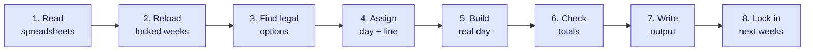
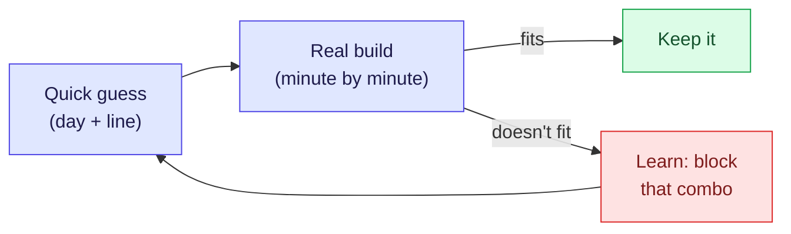
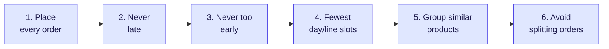

# How Frigilunch plans a week — a plain-language walkthrough

**One sentence:** every week, the program reads the orders, leaves anything
already promised untouched, spends its real effort getting the *very next*
few weeks right, takes a quick rough pass at everything further out, builds
the exact real-world day-by-day plan, and hands you a plan plus a short list
of what needs a human decision.

You run one command, once a week:

```
py create_plan.py --week 40 --year 2026
```

Everything below explains what that one command does.

---

## The flow, at a glance



*(Steps 4 and 5 actually go back and forth a few times before moving on —
see the next diagram. Each numbered step is explained with an example right
below.)*

---

## The 8 steps, one example each

| # | Step | Example |
|---|---|---|
| 1 | **Read the spreadsheets** | Order: *"5,000 trays chicken soup, due Oct 12."* Product card: *"only runs on Line 2, needs the mixer, allowed Tue–Fri."* |
| 2 | **Reload locked weeks** | Last week's run already locked weeks 38–41. This run reloads that plan untouched — nothing in it can move. |
| 3 | **Work out legal options** | An order due Oct 2 — but every day up to Oct 26 is already locked. Result: **zero legal days.** Flagged immediately, not silently dropped. |
| 4 | **Assign day + line** | Two products both need the same single mixer. The quick pass puts them on the same day, one per line — looks fine on paper. |
| 5 | **Build the real day** | Step 5 discovers both products need the mixer *at the same time*. One has to wait → pushes it past closing time → **bumped back to step 4** to try another day. |
| 6 | **Check totals** | 482 orders in → must equal scheduled + rejected, always. 430 + 52 = 482 ✅. If it doesn't add up, that's a bug. |
| 7 | **Write the output** | `planning_wk40.xlsx`, `capacity_dashboard_wk40.html`, `actie_vereist_wk40.csv`. |
| 8 | **Lock in next weeks** | Weeks 42–45 get saved. From now on, no run may ever move anything in them again. |

---

## The one loop that matters (steps 4 + 5)

You can't know exact changeover time until you know the whole day's line-up —
but you can't build the day's line-up until you have a rough idea what's
going into it. So the program bounces between a fast guess and a real check:



It repeats this until everything fits, or it runs out of thinking time.

---

## Inside the quick guess — how the solver decides

Picture a giant seating chart: hundreds of orders, dozens of open day+line
"seats", a long list of who's allowed to sit where. Checking every possible
seating chart one by one is impossible — there are more combinations than
makes sense to count. So instead of guessing randomly, it uses a *constraint
solver* (OR-Tools CP-SAT): give it the rules and what matters most, and it
rules out huge groups of hopeless combinations at once.

**What it cares about — strictly in this order.** It only looks at rule 2
once rule 1 is already as good as it can possibly be, and so on down the
list:



*(Full explanation of each, with an example, right below.)*

> **Example:** it will always place one more order, even a small unprofitable
> one, over "wasting" that slot to make the schedule look tidier — rule 1
> outranks rule 4. It will only split an order across two days (rule 6) as
> an absolute last resort, once nothing higher up the list can be improved.

**Groepering — what "group similar products" means (planner, 02/10).** Two
layers, in this order. First *identical products* — the same recipe in
another pack, linked in the "identiek product" column (VAT and VAT EW, DMB and
DMB GESNEDEN): same day, same line, back to back, smallest order first. Then
*same kapvorm* together. Both count when the solver picks the day and line,
and again when the day is put in order. On L2 almost nothing has a kapvorm
("NVT"), so there only the first layer applies.

> **Example:** VAT Bami Goreng is due Thursday, VAT EW Bami Goreng Monday.
> Where both are allowed on Monday, they go together on Monday, the smaller
> order first. If one of them may not run on Monday at all, they are split —
> grouping never costs an order.

**Within a day** the order is also chosen so the line runs without holes to
the end of its work: an order that needs a machine the other line is holding
goes before that line takes it, not hours after. And when the other line
stands still for sate, the sate starts as soon as that line is done, not at a
fixed slot at the end of the shift.

**How it searches, in short:**
- It gets a time budget, not "run until perfect" — by default up to 240
  seconds per attempt, up to 15 attempts.
- It always keeps the *best* answer found so far, even if time runs out
  before it's sure that's the best one possible.
- Every rejection from the real day-builder (step 5) becomes a permanent
  rule for every attempt after it: *"these two exact orders may never share
  this exact day again."*

> **Example:** attempt 1 puts two mixer-sharing products on the same day —
> rejected once it's built for real. Attempt 2 already knows to avoid that
> exact pairing, and finds both a clean spot elsewhere. A whole order book
> can have dozens of small conflicts like this, which is why it often takes
> several attempts before everything settles.

---

## Why the near future gets more thinking time than the far future

| Window | How much effort it gets | Why |
|---|---|---|
| Next ~4 weeks (about to lock in) | **Full effort** — loops until it's confident | A mistake here is permanent: locked weeks can never be replanned |
| Everything after that | **Quick pass** — one or two tries | It gets thrown away and redone from scratch next week anyway |

> **Example:** planning out to a delivery next November would make the near-term
> weeks wait behind months of pointless polishing on a guess nobody's committed
> to yet. So the far future gets a fast "good enough for now" pass instead,
> freeing up all the real thinking time for the part that's about to become
> permanent.

---

## When an order can't be placed

Only shown to a person when **no future run will ever fix it by itself**:

| Reason | Plain meaning |
|---|---|
| 🔒 **Arrived too late** | Its whole legal window already fell inside an already-locked week |
| ❓ **Missing information** | The product isn't in the database yet, or has no known production speed |
| ⚠️ **Day-assignment quirk** | It needs a specific neighbour order on its day and didn't get one — usually a quick manual fix |

Everything else that didn't make it in is left off that list on purpose —
it's still the program's job, and it may well succeed next week as the order
book shifts.

---

## What comes out

| File | What it is |
|---|---|
| `output/planning_wkNN.xlsx` | The plan — one tab per day |
| `output/capacity_dashboard_wkNN.html` | Open in a browser — how full each line is |
| `output/actie_vereist_wkNN.csv` | The short list above — orders that need a person |

For flags, file formats, and rule-by-rule detail: [README.md](README.md),
[ARCHITECTURE.md](ARCHITECTURE.md), [scheduler.md](scheduler.md).

