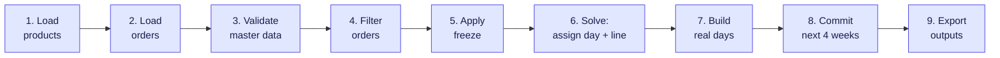
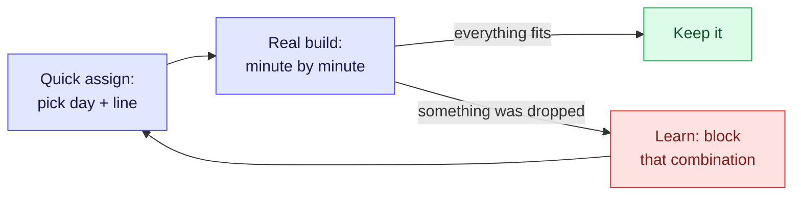

# How Frigilunch plans a week

**One sentence:** every week, the program reads the orders and product data, leaves already-frozen weeks untouched, assigns each remaining order to a day and line, builds the real minute-by-minute production timeline, locks the next four weeks, and writes the plan to Excel and a dashboard.

You run one command, once a week:

```
python -m frigilunch.cli --week 40 --year 2026
```

Everything below explains what that one command does.

---

## The nine stages, at a glance



*(Stages 6 and 7 go back and forth a few times before advancing — see the feedback loop below.)*

---

## The nine stages explained

### 1. Load products

Reads the generated `data/generated/products.json` — a structured version of the "Planning info.xlsx" spreadsheet. Every product becomes a record with its article number, line permissions, speed, allergen level, allowed weekdays, required machines, and position rules.

> **Example:** Art. 60920100 "DMB Kippensoep 900G" loads as: schaal (tray format) C2227-1H, speed 1750 units/hour, only allowed on L1, allergie_niveau 1, allowed weekdays Tue–Fri, requires the teriet machine.

### 2. Load orders

Re-reads the order book from `data/source_data/orderverwerking en planning.xlsm` (sheet `orderverwerking`) and saves a fresh `data/generated/orders.json`. Every order has an article number, quantity, customer, and delivery date.

> **Example:** Order 2026-10-01 for art. 60920100 (DMB Kippensoep 900G), 3,200 units, customer DMB, delivery date 2026-10-17 → 3200 / 1750 = 1.83 hours → rounded up to 115 min of production time.

### 3. Validate master data

Cross-checks orders against products. Orders for unknown article numbers, or for products with no configured production speed, are flagged immediately as `[WARN]`. They will be rejected later — the warning says why before the solve even starts.

> **Example:** `[WARN] WARN: unknown product '64255500' — order(s) will be rejected`. The article exists in the order book but has no entry in the product database yet. All orders for it are dropped before the solver even starts.

### 4. Filter orders

Narrows the order book to orders whose delivery date falls inside the planning horizon. The horizon extends to the furthest known delivery date. Orders already past due or outside the window are silently excluded.

> **Example:** Running week 44 (Oct 27 – Nov 1). An order due Sept 20 is already past — excluded. An order due Dec 15 is within the furthest known delivery date — kept. Result: 1,409 orders in → 579 after filtering.

### 5. Apply freeze

Reads `data/generated/plan_state.json` (the record of what earlier runs committed). Orders that already have a confirmed slot in a frozen week are separated out — they will be replayed exactly as built, without re-solving. The remaining orders are "free" and go to the solver.

**Example:** last week's run locked weeks 38–41. This run reloads those days untouched. Only orders for weeks 42 and beyond are open to change.

### 6. Solve: assign day and line

For each free order, the solver picks a production day and line (L1 or L2). It works within each order's legal window — respecting delivery dates, allowed weekdays, line permissions, and the frozen boundary. See the [feedback loop](#the-feedback-loop) section below.

> **Example:** VAT Bami Goreng (allowed Mon–Thu, L1 preferred, due Oct 17) has four legal slots: Mon Oct 13 L1, Tue Oct 14 L1, Wed Oct 15 L1, Thu Oct 16 L1. Friday is excluded by its day restriction. The solver places it on Wed Oct 15 L1 — three other same-format orders are already there, keeping changeovers short.

### 7. Build real days

For each assigned day, the program builds the actual minute-by-minute production timeline: start times, changeover durations, device staggering across the two lines. Frozen days from stage 5 are replayed from their saved slots; new days are built fresh.

> **Example — Wednesday Oct 15 L1:**
> ```
> 06:00  DMB Kippensoep 900G       90 min  (ombouw 0 min — first order)
> 07:30  ── changeover ──          20 min  (same schaal family)
> 07:50  VAT Bami Goreng           75 min
> 09:05  ── changeover ──          30 min  (schaal change)
> 09:35  DMB Tomatensoep           60 min
> 10:35  ...
> ```

### 8. Commit the next four weeks

The next four weeks of the newly built plan are written to `plan_state.json`. From this point forward, no future run may move anything in those weeks. This is what makes the plan reliable for the factory floor.

> **Example:** Running week 44 on Oct 27. The commit window covers Oct 27 – Nov 23 (4 weeks). Eighty-seven day schedules are written to `plan_state.json`. Next week's run (week 45) will replay all of them untouched and can only plan from Nov 24 onwards.

If `--dry-run` is set, this stage is skipped — useful for testing without committing anything.

### 9. Export outputs

Three files are written to `output/`:
- **`planning_wkNN.xlsx`** — one tab per production day, plus an overview
- **`capacity_dashboard_wkNN.html`** — open in a browser; shows how full each line is
- **`actie_vereist_wkNN.csv`** — orders that need a human decision (see [When an order cannot be placed](#when-an-order-cannot-be-placed))

---

## The feedback loop

Stage 6 (solve) and stage 7 (build) cannot happen independently — the real changeover time between two products depends on which products surround them, and you can only know that once you have the full day sequence. So the program uses a loop:



Each iteration:
1. The solver assigns every order to a (day, line) pair using an approximate capacity estimate.
2. The day builder builds each assigned day for real, with actual changeover times.
3. If a day is over-full, the orders that did not fit are noted, and the solver is told: "this exact combination of orders may not share this day again."
4. The solver re-runs, routing dropped orders elsewhere.

This repeats until everything fits, or until the time budget runs out. The best result found — the iteration that placed the most orders — is kept, even if it was not the last one.

**Why minutes, not seconds?** Each iteration runs the real day builder over the entire horizon. A typical run takes 3 iterations of 4–6 minutes each.

---

## What "locking" means and why it matters

Without locking, every weekly run could move already-confirmed production — a plan the factory floor prepared for on Monday could silently disappear by Wednesday's run. Locking prevents that.

At the end of each run, the plan for the next **four weeks** is written to `plan_state.json`. The next run reads this file and treats those weeks as untouchable. The factory can rely on those weeks being exactly as published.

The trade-off: an order that arrives after its production window is already inside a locked week has nowhere to go. It is flagged in `actie_vereist_*.csv` as needing a human decision — the program cannot fix it on its own.

---

## When an order cannot be placed

The action file (`actie_vereist_*.csv`) lists only orders that **no future run will ever fix on its own**:

| Reason | Plain meaning |
|---|---|
| Arrived too late | The whole legal production window falls inside already-locked weeks |
| Missing master data | The product is not in the database, or has no production speed configured |
| Proven infeasible | Every possible (day, line) was tried and none worked |

Orders dropped for capacity reasons — there simply was not enough room that week — are not in the action file. The program will try again next week as the order book shifts.

---

## The three output files

| File | Open with | Use it to |
|---|---|---|
| `planning_wkNN.xlsx` | Excel | Share the plan with the factory floor; one tab per production day |
| `capacity_dashboard_wkNN.html` | Browser | See which lines are full, where rejected orders went, and why |
| `actie_vereist_wkNN.csv` | Excel | Act on the short list of orders that need a human decision |
